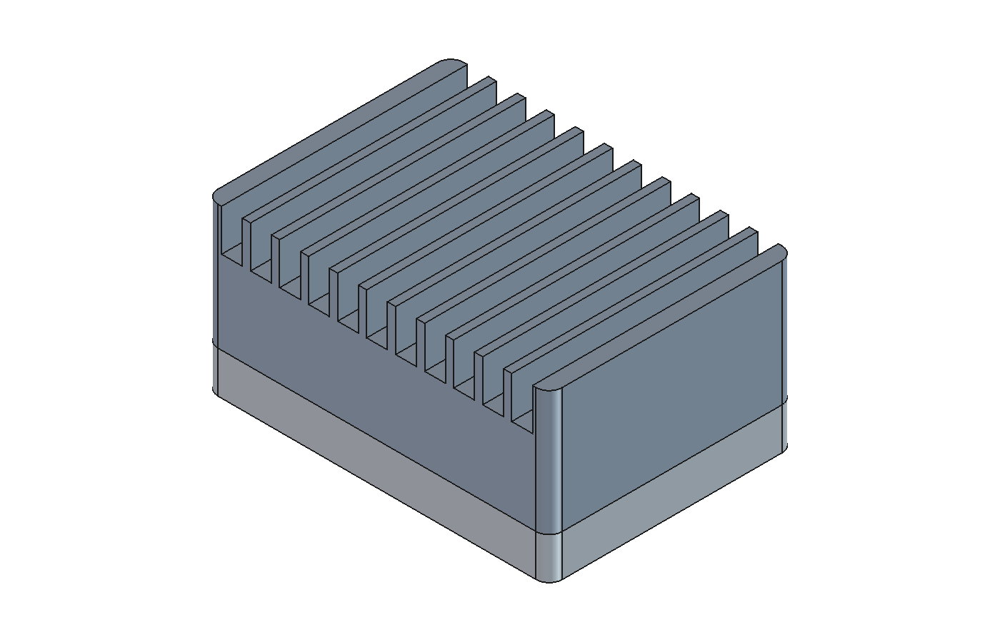
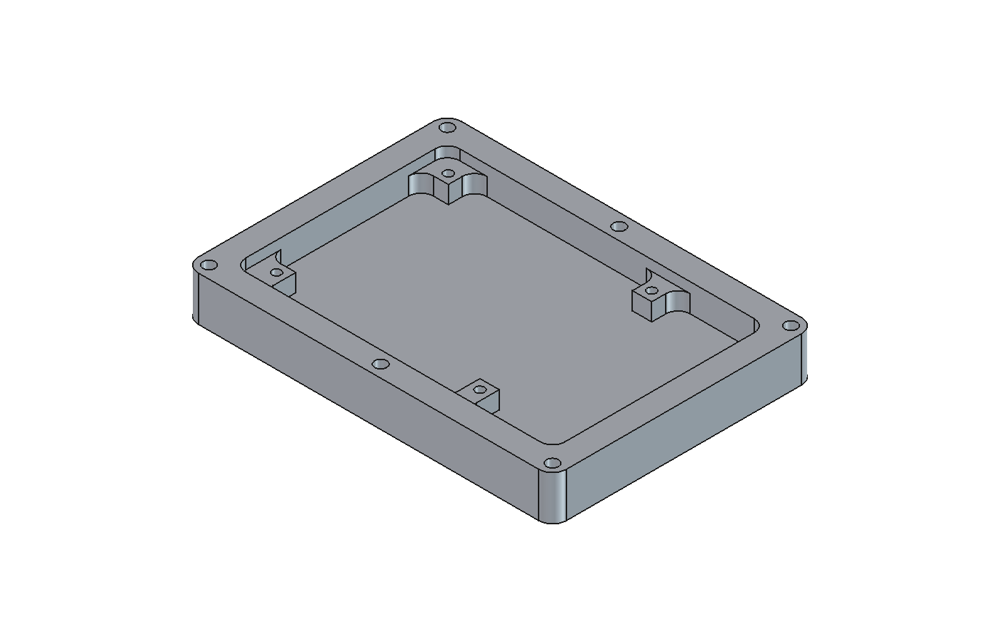
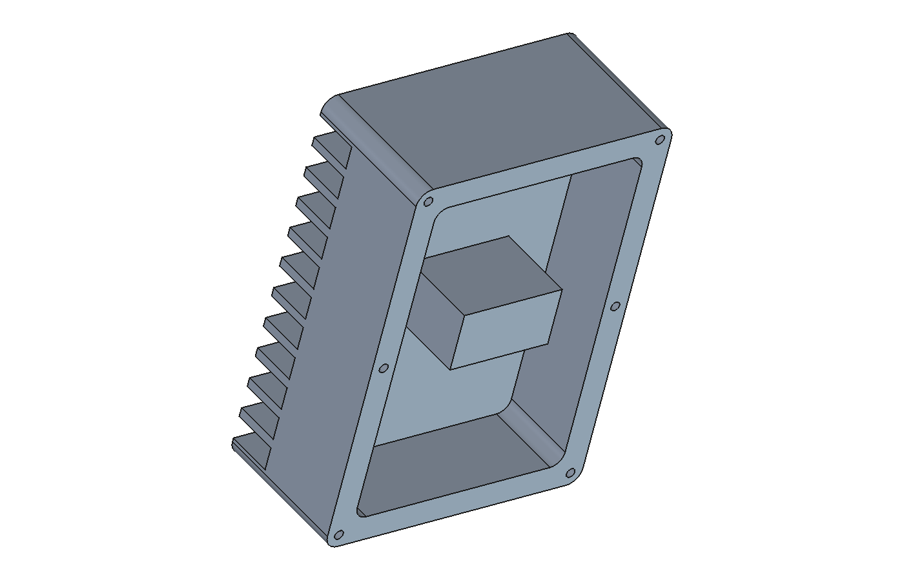
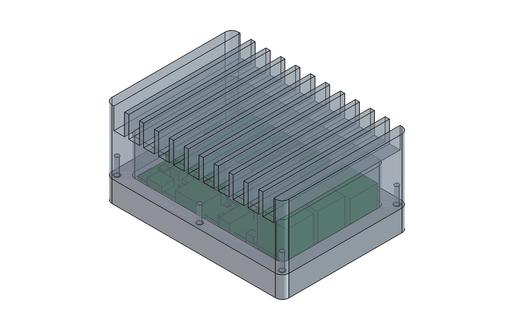

# Radxa Dragon Q6A Passive Aluminum Case (LUNYEE 3020 Nova)

A two-piece, fanless aluminum case for the **Radxa Dragon Q6A**, machined on
a **LUNYEE 3020 Nova** desktop CNC. The lid carries a pedestal that comes
down onto the QCS6490 SoC and the LPDDR5 memory through a thermal pad, and
a bank of open-ended fins on top that still air rises through, the same
arrangement as a ZimaBoard's top heatsink. The board is fully enclosed:
there are no port cut-outs, and you drill the cable hole yourself wherever
your wiring needs it.



| | |
|---|---|
| Outside size | 105 × 75 × 50.8 mm |
| Parts | Base (12.7 mm, ~152 g) and finned lid (38.1 mm, ~333 g), 6061-T6 |
| Board support | Four pillars merged into the walls, tapped M3 for the board's Ø3.5 mounting holes, 5 mm above the floor |
| Cooling | One 16 × 28.7 mm pedestal over the SoC and LPDDR5, 0.75 mm gap for a 1.0 mm thermal pad; 12 top fins, 12.7 mm tall, on an 8.85 mm pitch |
| Lid fixing | Six M3 screws up through the base walls into tapped holes in the lid rim |
| Headroom | About 6.75 mm above standard 14 mm Dupont housings on the 40-pin header, 7 mm above the USB-A stack |
| Tools | One 1/4" endmill and one 2.5 mm drill. Every inside corner is r3.5, so no 1/8" pass is needed |
| Machine time | Base ~52 min (one setup); lid ~93 min (setup A) + ~29 min (setup B, fins) |

## Files

| Path | What it is |
|---|---|
| `Q6APassiveCase.FCStd` | Parametric model, a Q6A clearance envelope, and the three CAM jobs (base, lid setup A, lid setup B) |
| [`gcode/`](gcode/) | Ready-to-run G-code, one file per tool, with the spindle dial setting in each file name |
| [`tools/split_for_lunyee.py`](tools/split_for_lunyee.py) | Rebuilds `gcode/` from FreeCAD's posted output |
| [`step/`](step/) | STEP files of both parts, in assembled position, for other CAM software |

## How it fits together



The board sits on four pillars cut from the base. The pillars run into the
walls rather than standing free, because a free-standing boss beside a wall
leaves a 2–4 mm gap that a 1/4" endmill cannot get into. No component on the
underside of the board lands on a pillar top: this was checked against Radxa's
v1.21 STEP model, and the nearest part (C0419) is 0.6 mm clear of pillar 2.

The lid is machined from the rim side. Its pedestal face and its rim are both
the untouched top surface of the plate, so they are exactly coplanar. The gap
between the pedestal and the chips is therefore set only by depths in the
base, which are all cut in one setup from one Z zero:

```
rim  ──────────────────────────────  (plate top of the base, Z0)
       0.75  tim_gap   → 1.0 mm pad compressed 25 %
SoC  ▄▄▄▄▄▄▄▄  1.0     chip_h (QCS6490 and LPDDR5 are both 1.0 mm)
PCB  ════════  1.2     pcb_t
pillar top             2.95 mm below the rim
       5.0  so_h
floor ─────────────── 7.95 mm below the rim (4.75 mm floor left)
```





### The fins

Heat goes from the chips through the pedestal into the 3.9 mm lid ceiling,
which spreads it under the fins. The fins run front to back (the 75 mm way)
and are open at both ends, so air is drawn in at the ends and rises out
between them, with no fan. This is the layout of the ZimaBoard's top
heatsink. Measured from IceWhale's model, its die-cast fins are about 1.5–2 mm
thick and 6 mm tall on a 7.2 mm pitch. A 1/4" endmill cannot cut gaps that
narrow, so these fins keep the same open-channel layout at a size the tool
can cut:

| | ZimaBoard (die-cast) | This lid (milled) |
|---|---|---|
| Fin thickness | ~1.5–2 mm | 2.5 mm (ends 5.1 mm) |
| Gap | ~5.2 mm | 6.35 mm, one 1/4" slot |
| Height | ~6 mm | 12.7 mm |
| Pitch | 7.2 mm | 8.85 mm |

For fins this tall and 75 mm long, the commonly cited optimum gap for
natural convection works out to about 6.7 mm, so the tool-width gap is close
to ideal. The two end fins are thicker so the r4 outer corners do not leave
knife-edge slivers.

The fins roughly double the outside surface (about 0.054 m² against
0.030 m² without them). These are hand estimates, not measurements, assuming 8 W
sustained in a 25 °C room. Bare aluminum should hold the case near 50–55 °C
and the SoC near 60 °C. Black anodizing or high-emissivity paint on the
outside should take another 10 °C or so off. Without the fins, the same
estimate gives a case near 70 °C.

Clearances checked against the full STEP model (1,261 solids): no part of
either case half intersects the board, the lowest part under the board
(the 2-pin connector, 3.5 mm) is 1.5 mm off the floor, and the only parts
under the pedestal taller than 0.8 mm are the SoC, the LPDDR5 and the SPI
flash beside them, which is 0.73 mm clear.

**Aluminum blocks Wi-Fi and Bluetooth.** Use Ethernet, or route an external
antenna lead out through your cable hole.

## What to buy

Prices and links for the tools are in the aluminum-cyberdeck sample's
[tools and stock](../../aluminum-cyberdeck/docs/tools-and-stock.md) page; the
same endmill, drill and tap are used here.

| Item | Use |
|---|---|
| 6061-T651 plate, **1/2" × 6" × 5"** | Base |
| 6061-T651 plate, **1-1/2" thick, cut to 4.5" × 3.5"** | Lid blank (see the size limits under setup A) |
| Machine vise, parallels, and a vise stop | Both lid setups |
| **1/4" ER11 collet** | The 3020 Nova ships with a 1/8" collet only |
| **T1:** 1/4" 3-flute carbide endmill for aluminum, **1-1/4" flute length** (e.g. Lakeshore Carbide 360014LX) | All milling. The deepest cut is the lid's outline in setup A, 26.4 mm, so a standard 3/4" or 1" flute is too short |
| **T2:** 2.5 mm carbide drill, **1/8" shank**, ≥ 11 mm flute (e.g. Makera 2.5 × 12 mm) | Tap holes and pilots, 10 mm deep at most |
| M3 × 0.5 spiral-flute tap, tap wrench | 10 holes (4 in the pillars, 6 in the lid rim) |
| 3.4 mm (or #29) drill, hand or drill press | Opens the 6 base pilots into M3 clearance holes |
| 6 × **M3 × 20** socket head screws | Lid to base, from underneath |
| 4 × **M3 × 6** pan or low-head screws, head Ø 5.6 mm or less | Board to pillars. The USB-C shell is 3.2 mm from hole 1 |
| Soft thermal pad, **1.0 mm** | Cut to 14 × 12 mm (SoC) and 15 × 12.4 mm (LPDDR5) |
| 4 × stick-on rubber feet, ≥ 4 mm tall | Keep the screw heads off the desk |
| Double-sided tape and CA glue, toe clamps | Base workholding (see below) |

## The machine

[LUNYEE 3020 Nova](https://www.cnx-software.com/2026/08/27/lunyee-3020-nova-review-a-desktop-cnc-router-with-710w-spindle-tested-with-ugs-and-easel-software/):
300 × 200 × 80 mm travel, HG15 rails and 1204 ball screws on all axes, NEMA 17
motors, 5,000 mm/min maximum, a GRBL-compatible 32-bit controller, and a 710 W
trim router with a **six-step manual dial (6,000–30,000 rpm)**. The router is not
wired to the controller. The G-code cannot turn it on or set its speed, so:

* every file name ends in `_DIAL-n`, the dial setting it needs;
* every file **stops with M0 before the first cut**. Set the dial, switch the
  router on, then press Cycle Start;
* every file ends lifted 5 mm clear, so you can switch the router off.

LUNYEE does not publish the speed of each dial step. The feeds assume the six
steps are spread evenly over 6,000–30,000 rpm:

| Dial | 1 | 2 | 3 | 4 | 5 | 6 |
|---|---|---|---|---|---|---|
| Assumed rpm | 6,000 | 10,800 | 15,600 | 20,400 | 25,200 | 30,000 |

The feeds stay inside a safe chipload if the real speed is 20 % off either
way. If you have a tachometer, measure dial 3 and edit `DIAL_RPM` in
`tools/split_for_lunyee.py`.

### Feeds and speeds

| Tool | Dial | Feed | Plunge | Cut |
|---|---|---|---|---|
| T1 1/4" 3-flute | 3 | 800 mm/min (0.017 mm/tooth) | 200 mm/min, 2° helix entries | Adaptive clearing at 0.635 mm (10 %) stepover and 2.5–4.3 mm depth. Outer profiles at 1.0 mm depth per pass, after a widening pass further out (2.5 mm on the base, 4.5 mm on the lid) so chips can escape the trench. Fin gaps are single full-width slots, 1.0 mm per pass, zig-zag, each pass starting and stepping down in open air 5.5 mm beyond the part |
| T2 2.5 mm drill | 1 | — | 150 mm/min | Pecks every 0.8 mm. Expanded to plain G0/G1 moves, so no canned-cycle support is needed |

Use an **air blast or a mist of WD-40 / isopropyl** throughout. Recut chips are
what breaks a 1/4" endmill in a 25 mm deep trench. If the profile passes
chatter, turn feed override down to 80 % in your sender; it only costs time.

## Machining

The base is one setup on the table. The lid is two setups in a vise: rim
side first, then flipped for the fins. Every file's header states its zero.

**Z reach:** the review notes the trim router has to sit low in its mount to
reach the table. With the lid blank in a vise the work is much higher, so
move the router up in its clamp until the T1 tip can reach 27 mm below the
blank top and still retract 5 mm above it, inside the 80 mm Z travel.

### Base (1/2" plate)

**Zero:** X0 Y0 is the **front-left corner of the plate**, and Z0 is the
**top of the plate**. The part is centred on a 152.4 × 127 mm (6" × 5") plate.

**Workholding:** the tool reaches from X 14.9 to 137.6 mm and from Y 17.2 to
109.9 mm. Clamp only in the outer 12 mm of the plate, and stick the plate down
with double-sided tape plus CA glue as well, so the plate cannot shift once
the clamps are near the cut. Keep clamps below 5 mm above the plate top, the
rapid height. The outer profile cuts 0.3 mm into the spoilboard.

| # | File | Tool | Dial | Time |
|---|---|---|---|---|
| 1 | `base_1of2_T2-2.5mm-drill_DIAL-1.nc` | 2.5 mm drill, 1/8" collet | 1 | ~2 min |
| 2 | `base_2of2_T1-quarter-inch-endmill_DIAL-3.nc` | 1/4" endmill, 1/4" collet | 3 | ~50 min |

File 1 drills the four pillar tap holes and six 10 mm pilots for the case
screws. File 2 clears the cavity to the pillar tops, then to the floor, then
cuts the outline: one widening pass, then the final pass, which leaves four
1.2 mm tabs on the long sides.

**Between files:** switch the router off, change bit and collet, and re-zero
**Z only** on the plate top, away from the drilled holes. Leave X and Y alone.

### Lid, setup A: rim side up (1-1/2" blank in the vise)

| # | File | Tool | Dial | Time |
|---|---|---|---|---|
| 1 | `lid_setupA_1of2_T2-2.5mm-drill_DIAL-1.nc` | 2.5 mm drill | 1 | ~1 min |
| 2 | `lid_setupA_2of2_T1-quarter-inch-endmill_DIAL-3.nc` | 1/4" endmill | 3 | ~92 min |

**Blank:** 1-1/2" plate, **4.5" × 3.5" (114.3 × 88.9 mm) at most** and at
least 107 × 77 mm. The outline passes mill all the excess to chips, but they
only reach 10.85 mm past the lid. A bigger blank leaves slivers at its corners
that would break loose in setup B. If your blank is bigger, raise `widen_lid`
in the CAM sheet and post again.

**Hold:** long side along X, against the **fixed jaw at the back**, left end
against a stop. Grip only the bottom ~10 mm: the jaw tops must be at least
28 mm below the blank top. The outline goes 26.4 mm deep, and the widening
pass runs a few mm past the blank's faces, over the jaws. After zeroing,
lower or swing the stop clear, because the cutter runs up to 6 mm past the
blank's left end.

**Zero:** X0 = left end of the blank, Y0 = back face of the blank (at the
fixed jaw), Z0 = top of the blank.

File 1 drills the six rim tap holes. File 2 clears the 21.5 mm cavity around
the pedestal and cuts the outline 26.4 mm deep, 1 mm past the fin roots. Do
not touch the blank top: it becomes the pedestal face and the rim. The part
stays joined to the bottom 11.7 mm of the blank.

### Lid, setup B: fin side up (flipped in the vise)

| # | File | Tool | Dial | Time |
|---|---|---|---|---|
| 1 | `lid_setupB_1of1_T1-quarter-inch-endmill_DIAL-3.nc` | 1/4" endmill | 3 | ~29 min |

**Hold:** flip the lid over, rim down on parallels, long side along X. The
fins and outline are symmetric, so it does not matter which end goes left.
Grip the walls machined in setup A, with the **jaw tops no more than 23 mm
above the parallels**. That is at least 2 mm below the fin roots, which the
slots cut down to, running out over the jaws. The lid is hollow, so tighten
the vise firmly but do not crank it.

**Zero:** X0 = the lid's left end wall, Y0 = the lid's back wall (at the
fixed jaw), Z0 = the top of the part. The rest of the blank overhangs the
walls, so you cannot touch them off directly. **Edge-find the fixed jaw face
and the stop before you load the part**, then bring the part against both.
After zeroing, lower or swing the stop clear: the cutter runs up to 11 mm past
the left wall, down to the fin roots. Make sure the machine can travel at
least 8 mm left of X0 and 8 mm behind Y0.

The file first cuts the outline 12.2 mm down, overlapping setup A's cut by
0.5 mm. That mills away all of the leftover blank, so nothing comes loose.
Then it cuts the 11 fin slots, 12.7 mm deep, one gap at a time. Expect a faint
line where the two outlines meet; a few strokes with a file blend it.

### After machining

1. Cut the four tabs on the base with a hacksaw or flush cutter, and file
   them flush. The lid has no tabs.
2. **Base:** open the six wall pilots to 3.4 mm all the way through (drill
   press, from the rim side, following the pilot). Tap the four pillar holes
   M3, about 6 mm deep.
3. **Lid:** tap the six rim holes M3, about 8 mm deep (the holes are 10 mm).
4. Deburr everything, including the fin edges. A black anodize or a
   high-emissivity paint on the *outside* noticeably improves cooling: bare
   aluminum radiates very little heat. Mask the pedestal face and the rim.
5. Drill your cable hole. Stay clear of the screw holes on the wall
   centreline: from the outside, 3.5 mm in from each corner and in the middle
   of the two long sides.

## Assembly

1. Fit the board on the pillars with 4 × M3 × 6 screws.
2. Put a 1.0 mm pad on the SoC and one on the LPDDR5 (the two large packages
   in the middle of the board, side by side).
3. Lower the lid on. Fit 6 × M3 × 20 screws from underneath and tighten them
   evenly, working diagonally. The pads compress by about 0.25 mm.
4. Stick the feet on.

## Changing the design

Everything is driven by two spreadsheets in `Q6APassiveCase.FCStd`.

| Sheet | Alias | Default | Change it when |
|---|---|---|---|
| Design | `tim_gap` | 0.75 mm | You use 0.5 mm pads (0.35 mm) or something else |
| Design | `base_t`, `lid_t` | 12.7, 38.1 mm | Your plate measures differently. Measure it. `lid_t` only changes the fin height |
| Design | `lid_cav_d`, `lid_body_t` | 21.5, 25.4 mm | You want more or less headroom (the ceiling is `lid_body_t - lid_cav_d`) |
| Design | `fin_t` | 2.5 mm | Fin thickness. The end fins (`fin_end_t`) adjust to suit |
| Design | `fin_gap`, `n_gaps` | 6.35 mm, 11 | Leave as they are. The gap is one slot of the 1/4" tool, and setup B has one slot operation per gap |
| Design | `wall`, `cav_*`, `r_in`, `r_out` | | Resizing the case |
| CAM | `stock_l`, `stock_w` | 152.4, 127 mm | Your base plate is a different size |
| CAM | `lid_blank_l`, `lid_blank_w`, `widen_lid` | 114.3, 88.9, 4.5 mm | Your lid blank is a different size. Raise `widen_lid` for a bigger blank |
| CAM | `seam_a`, `seam_b` | 1.0, 0.5 mm | How far setup A cuts past the fin roots, and how much setup B overlaps it |
| CAM | `tab_hold`, `overcut`, `widen`, `pilot_d` | 1.2, 0.3, 2.5, 10 mm | Base tab thickness, spoilboard cut, base trench width, pilot depth |

After a change, recompute, then post each job (select it, CAM → Post
Process) and rebuild the per-tool files:

```
python3 tools/split_for_lunyee.py base_posted.nc --part base --out gcode
python3 tools/split_for_lunyee.py lidA_posted.nc --part lid_setupA --out gcode \
    --zero "X0 = left end of the BLANK (vise stop), Y0 = back face of the BLANK (fixed jaw at the back), Z0 = top of the blank. Rim side UP"
python3 tools/split_for_lunyee.py lidB_posted.nc --part lid_setupB --out gcode \
    --zero "X0 = left end wall of the LID BODY (vise stop), Y0 = back wall of the LID BODY (fixed jaw at the back), Z0 = top of the part. Fin side UP"
```

Depths, the pad gap, the fin height and the tab heights all follow the
spreadsheets. The CAM operations select faces of the model. If a change alters
the model's topology rather than its dimensions (for example a different
number of fins), re-check each operation's Base Geometry before posting.

## Sources

* LUNYEE 3020 Nova specifications and review:
  [CNX Software](https://www.cnx-software.com/2026/08/27/lunyee-3020-nova-review-a-desktop-cnc-router-with-710w-spindle-tested-with-ugs-and-easel-software/),
  [launch announcement](https://persportaal.anp.nl/artikel/CSN-130626012/lunyee-launches-3020-nova-cnc-router-to-make-desktop-cnc-more-powerful-and-easier-to-start)
* Radxa Dragon Q6A 3D STEP, 2D drawing and placement map, v1.21:
  [Radxa Dragon Q6A docs](https://docs.radxa.com/dragon/q6a)
* Cooling the SoC with paste and the LPDDR5 with a pad:
  [Radxa forum](https://forum.radxa.com/t/best-heatsink-cooling-solutions-for-dragon-q6a/30123)
* ZimaBoard 2 fin dimensions: measured from IceWhale's published 3D model of
  the board
