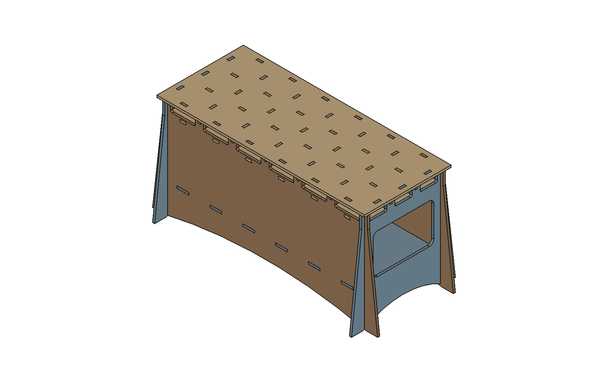
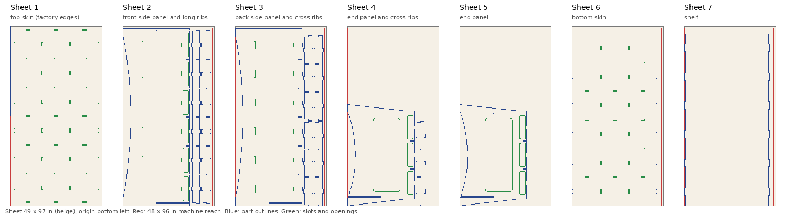

# Tab & Slot Torsion Box Workbench

A parametric workbench in FreeCAD, cut from MDF on a CNC router. The top is a
**torsion box**: a grid of ribs between two skins. It is light, and it stays
flat because the grid resists twisting. Every joint is tab and slot, so the
parts locate themselves when you glue up.

The front, back and end panels run in one piece from the floor to the
worktop. They are the legs and the outer walls of the torsion box at the same
time, so the load on the top goes straight down to the floor. The panels
cross egg-crate style at the corners. Below the box the end panels splay
outward for stability, while the feet stay under the ends of the worktop.

This is the general-purpose version of the [LR4 torsion table](../TorsionTableCAD/README.md).
That table carried rails along its sides for a LowRider CNC. Here the box
edges are the bench edges, and the cells behind them open out as storage
cubbies.



## What's in this folder

| File | What it is |
|---|---|
| `tab_slot_workbench.FCStd` | The model: parts, assembly, cut list and drawings |
| `build_workbench.py` | The generator that builds the `.FCStd` from scratch |
| `fem_splay_study.py` | The FEM study that set the leg splay |
| `fem_splay_results.csv` | Its results, one row per splay |
| `load_capacity.py` | Hand calculation of how much load the bench carries |
| `build_cam.py` | Builds and maintains the CAM jobs that cut the parts from sheets |
| `cam/nest.png` | How the parts lie on each sheet |
| `drawings/Sheet1_Overview.pdf` | General arrangement, overall sizes and cut list |
| `drawings/Sheet2_TorsionBox.pdf` | Inner ribs and skins, with joinery sizes |
| `drawings/Sheet3_Frame.pdf` | Side panels, end panels and shelf |
| `drawings/Sheet4_Assembly.pdf` | Five-step assembly instructions |

The PDFs are exported from the model as saved. Change the model and
re-export them (see below) to get drawings for your own sizes.

## The parts

| Part | Qty (default) | Notes |
|---|---|---|
| Side panel, front | 1 | Floor to worktop. Storage openings along the top. |
| Side panel, back | 1 | The same, solid by default (`open_back`) |
| End panel | 2 | Floor to worktop. Storage openings, lightening window. |
| Top skin | 1 | Every panel and rib tabs up through it |
| Bottom skin | 1 | Sits inside the frame, tabs into the side panels |
| Long rib, inner | `ny − 1` | |
| Cross rib, inner | `nx − 1` | |
| Shelf | 1 | Tabs into the side panels |

How the joints work:

- **Corners:** the side panels are slotted from the top and the end panels
  from the bottom, half the panel height each. The end panels sit in from the
  side-panel ends by `corner_proud`, so the slots land mid-panel and actually
  lock.
- **Inner ribs:** the long ribs drop into slots at the top of the end panels,
  and the cross ribs drop over the long ribs and into slots at the top of the
  side panels.
- **Skins and shelf:** every rib has tabs into both skins. The bottom skin and
  the shelf are held by tabs in mortises cut through the side panels.

## Changing the design

Every size lives in the **Design** spreadsheet. Change a value, press
**Recompute** (Ctrl+R), and the parts, the assembly, the cut list and the
drawings all update. If nothing moves, select the spreadsheet, right-click it
and choose **Mark to recompute**, then recompute again.

The drawings follow too:

- **Scales and captions.** Each view picks the largest standard scale (1:5,
  1:8, 1:10, 1:12.5, 1:15, 1:20 and so on) that fits its box on the sheet.
  The box sizes and the scale for every view are in the **Layout**
  spreadsheet, worked out from Design.
- **Dimensions.** The overall dimensions are attached to vertices of the 3D
  parts, so they keep measuring the right corners when sizes, thickness or
  cell counts change.

To get new PDFs, open each page (double-click it in the tree) and use
File → Export PDF.

The settings you will use most:

| Setting | Default | What it does |
|---|---|---|
| `mdf_size` | 0.5 | MDF thickness in inches: 0.25, 0.5 or 0.75 |
| `t_adjust` | 0 mm | Your measured sheet thickness minus nominal. MDF often runs slightly off. |
| `t_s`, `t_r`, `t_l` | `=t_nom` | Skin, inner rib and frame panel thickness. Type a value to mix thicknesses, for example ¾ in panels with ½ in inner ribs. |
| `fit` | 0.3 mm | Clearance added to every slot. Set it from your test cut. |
| `top_L`, `top_W` | 72 in, 30 in | Worktop size. Set them to your sheet size for a top cut from one full sheet, for example 97 × 49 in for MDF sold in 49 × 97 in sheets. |
| `rib_h` | 4 in | Box depth between the skins, which is also the cubby height |
| `nx`, `ny` | 6, 3 | Number of cells along the length and across the depth |
| `open_front`, `open_back`, `open_ends`, `open_inner` | 1, 0, 1, 0 | Storage openings on or off. `open_inner` cuts through the inner long ribs to make full-depth tunnels, which weakens the box. |
| `bench_h` | 36 in | Floor to top surface |
| `splay_W` | 3.5 in | How far the end-panel edges flare out at the floor, front and back. See the FEM study below. |
| `splay_L` | `=ov` | How far the side-panel ends flare out at the floor. It can't exceed `ov`, so the feet never stick out past the ends of the worktop; the `chk_ends` check flags it if they do. |
| `corner_proud` | 1 in | How far the end panels stand out past the side panels. 0 gives flush corners, which also lose the interlock. |
| `shelf_z` | 10 in | Shelf height |

The **CHECKS** rows at the bottom of the sheet should all read `OK`. If one
doesn't, it names the setting that is out of range.

Heavier work calls for ¾ in throughout. ½ in suits a lighter bench. ¼ in
works for skins over ½ in ribs, but is too thin for the frame panels on a
bench this size.

## Choosing the leg splay (FEM study)

The splay was set with a FreeCAD FEM study of the whole bench, using
`fem_splay_study.py` and the CalculiX solver.

**The model.** All 14 parts, as assembled, with the joints bonded as if glued.
The feet are fixed to the floor. The worktop carries 4000 N (about 900 lbf)
straight down, plus a 900 N (about 200 lbf) sideways push along both the
length and the depth. The material is MDF: E = 3.5 GPa, bending strength
about 28 MPa. The mesh is about 350,000 nodes, and a single-panel check
showed the sway is mesh-converged to within 0.2%.

| Splay | Angle | Sway along length | Sway across depth | Stiffness across depth | Leg stress (99th pct) | Push to tip it over, across depth | Toe past worktop edge |
|---|---|---|---|---|---|---|---|
| 0 in | 0° | 0.021 mm | 0.309 mm | 1.00× | 0.51 MPa | 0.40 × weight | — |
| 2 in | 3.8° | 0.021 mm | 0.255 mm | 1.21× | 0.48 MPa | 0.46 × weight | 1.5 in |
| **3.5 in** | **6.5°** | **0.020 mm** | **0.219 mm** | **1.41×** | **0.45 MPa** | **0.50 × weight** | **3.0 in** |
| 6 in | 11.1° | 0.020 mm | 0.171 mm | 1.81× | 0.44 MPa | 0.57 × weight | 5.5 in |
| 12 in | 21.5° | 0.020 mm | 0.104 mm | 2.97× | 0.38 MPa | 0.74 × weight | 11.5 in |

`fem_splay_results.csv` has every point from 0 to 12 in.

What the study shows:

- **Strength doesn't limit the splay.** Leg stress stays under 0.6 MPa at
  every angle, about 1/50 of what MDF can take, and the worst stress anywhere
  in the bench is around 2 MPa.
- **The splay helps across the depth, which is the direction a bench racks
  in.** Each inch adds roughly 9% racking stiffness and raises the push needed
  to tip the bench. The improvement keeps going, with no point where it
  levels off.
- **Splaying the side-panel ends does nothing structurally.** Sway along the
  length stays at 0.020 mm at every angle, because a 72 in panel is already
  enormously stiff in its own plane. So `splay_L` is limited to `ov`, which
  keeps the feet under the ends of the worktop, and nothing is lost.
- **The real limit is your feet.** Splayed feet stick out past the worktop
  and get in the way when you stand at the bench. 3.5 in keeps them within
  3 in of the worktop edge. That gives 1.4× the racking stiffness of vertical
  sides and a quarter more push to tip the bench over.

If you never stand close to the long sides, more splay is stronger still.

**Checked again in ½ in MDF.** The thinner panels flex more, but the splay
helps by the same proportion. Sway across the depth is 0.541 mm with vertical
sides and 0.382 mm at 3.5 in splay, which is 1.42× stiffer. That's the same
gain as in ¾ in, so 3.5 in stands. The ½ in leg stress at 3.5 in is 0.70 MPa,
still well under 1/30 of MDF's strength.

The table above is from the 72 × 30 in bench in ¾ in MDF. A bench that is deeper front to
back is stiffer across the depth to begin with; rerun the study at your size
to see by how much.

To rerun the study with your own loads, run it from a terminal with
FreeCAD's command-line binary. It doesn't touch a running FreeCAD session:

```bash
FEM_SPLAYS=0,2,3.5,6 FEM_V=4000 FEM_H=900 "$FREECAD_CMD" fem_splay_study.py
```

Set `FREECAD_CMD` to your `freecadcmd` (it sits next to the `freecad`
binary). Each splay takes about 4 minutes and 6 GB of RAM. The script sweeps
`splay_W` by default (`FEM_PARAM` picks another), and documents every setting
at the top. It opens the model read-only and works on a copy, so the saved
file is never changed.

The study is linear and static, and it treats MDF as uniform. It doesn't
model joints slipping before the glue sets, or wear in the joints over time.
Use it to compare designs, not as a load rating.

## How much load it carries

`load_capacity.py` works this out by hand from the Design sheet, so it
follows any change to sizes or thickness:

```bash
"$FREECAD_CMD" load_capacity.py
```

Or, with the model open, paste
`exec(open("/path/to/load_capacity.py").read())` into FreeCAD's Python
console.

It checks six ways the bench could fail. These are the results for a 97 × 30
in top in ½ in MDF:

| How it could fail | Breaks at | Working load | Left in place for weeks |
|---|---|---|---|
| **One object on one skin cell, 2 in footprint** | **605 lb** | **200 lb** | **100 lb** |
| Feet crushing on the floor (even load) | 13,900 lb | 4,640 lb | 2,320 lb |
| Rib shear next to the side panels | 22,300 lb | 7,450 lb | 3,725 lb |
| Side panels buckling between shelf and bottom skin | 21,700 lb | 7,220 lb | 3,610 lb |
| Skin bending between ribs (even load) | 63,900 lb | 21,300 lb | 10,600 lb |
| Whole box bending, front to back | 206,600 lb | 68,900 lb | 34,400 lb |

- **The working load** is the breaking load divided by 3, a safety factor that
  covers variation between sheets.
- **For loads left in place**, divide by 2 again, because MDF slowly sags
  under a load that stays on it.
- **Material values** are conservative figures for industrial MDF: 24 MPa
  bending strength, 2.8 GPa stiffness, 5 MPa edge shear and 12 MPa edge
  crushing. The script header shows how to use your own.

How each line is worked out:

- **One skin cell** is a flat plate supported on its four ribs, with the load
  on a 2 in circle. This uses Roark's *Formulas for Stress and Strain*, Table
  11.4. It assumes the ribs only prop the skin up; glued, the skin is held
  more firmly, so the real figure is somewhat higher.
- **Box bending and shear** treat the torsion box as a beam spanning front to
  back onto the side panels. The skins act as flanges and the cross ribs and
  end panels as webs.
- **Buckling** treats each side panel as a plate between the shelf and the
  bottom skin.
- **Feet** counts only the four side-panel feet, which is conservative.

In practice, a load spread over the top can run to a few thousand pounds. The
limit you will actually meet is a heavy object resting mid-cell: a vise,
anvil or jack-stand foot. Keep heavy point loads over a rib, or put a plate
under them that spans two ribs. A ¾ in top skin (`t_s = 19.05 mm`) raises the
cell limit about 2.25×. More cells (a higher `nx` or `ny`) make each cell
smaller, which also raises it.

## Cutting it

The model holds seven CAM jobs, one per 49 × 97 in sheet, for a ¼ in end mill
on a machine that reaches 48 × 96 in:



| Sheet | Parts |
|---|---|
| 1 | Top skin. It is the whole sheet, so only its slots are cut and the factory edges stay. |
| 2 | Front side panel, plus the inner long ribs |
| 3 | Back side panel, plus up to four inner cross ribs |
| 4 | One end panel, plus the remaining cross ribs |
| 5 | The other end panel |
| 6 | Bottom skin |
| 7 | Shelf |

Every sheet runs four operations:

1. **SCORE** traces the outlines just deep enough to see.
2. **STOP** (M0) is your chance to drive hold-down screws where the score lines
   show they won't be hit.
3. **CUT slots and openings** while the part is still held by the sheet around
   it.
4. **CUT outlines** at full depth.

Both cuts carry a dogbone dressup, so every inside corner is cleared for a
square-edged mating part.

### Setting up the machine

- **Sheet position.** Lay the sheet with its long side along machine Y and
  its corner at X0 Y0. On sheet 1 the factory edges are the finished edges of
  the top, so get the sheet square to the axes.
- **Z0** is the top of the material at its highest point.
- **`surf_var`** in the **CAM** spreadsheet is how far the lowest spot of the
  material sits below that. The default of 14 mm was measured on one
  particular LowRider table. **Measure yours** and set it: every depth is
  worked out from it. The scoring pass goes to `surf_var + 0.5 mm`, and the
  cut to the material thickness + `cut_over` + `surf_var`.
- **Tool, speeds and feeds** are in the CAM spreadsheet: a ¼ in single-flute
  end mill at 12,000 rpm, 3000 mm/min cutting, 600 mm/min plunge, 2 mm per
  pass.

The G-code files are written to `cam/` by the generator (see below), or from
any job with the **Post Process** button. They use the grbl post with metric
units.

### Why the frame is 95.5 in long

Two settings in this model were changed so every part can be cut on a 48 × 96
in machine:

- **The rule.** With a ¼ in cutter, any edge that gets cut must sit at least
  ⅛ in inside that reach, so no cut part can be longer than 95.75 in.
- **`ov = 0.75 in`** sets the top skin's overhang, making the side panels
  95.5 in long instead of 96.
- **`splay_L = 0`** squares the side-panel ends. The FEM study showed that
  splay adds no strength, and the feet still sit under the worktop.

### What follows the design, and what doesn't

What updates by itself:

- **Part shapes.** Every part in a job is a clone of the real Body, so its
  shape follows the Design spreadsheet.
- **Positions** are expressions in the **Nest** spreadsheet.
- **Depths, feeds and speeds** are expressions in the **CAM** spreadsheet.

For size changes (lengths, thickness, tab sizes, radii and so on), recompute
and the toolpaths follow.

**Changes that alter a part's topology need one extra step.** These are
`nx`, `ny`, the `open_*` toggles and `end_window`. After any of them, run
this in FreeCAD's Python console:

```python
import sys; sys.path.insert(0, "/path/to/tab-and-slot-workbench")
import build_cam as bc
bc.update_cam()
```

It does three things:

1. Re-lays any sheet whose rib count changed.
2. Points every operation at its parts' current top faces. Those face
   references go stale when slots are added or removed.
3. Re-checks every toolpath.

Until you run it, the affected operations show as errors in the tree.

**The Nest spreadsheet's CHECKS rows** flag a layout that no longer works:

- rib counts that need `update_cam()`
- more ribs than fit beside a panel
- a part beyond the machine's reach
- ribs and frame panels of different thickness sharing a sheet
- a top skin that is no longer the full sheet

### Before you cut

`post_job()` writes a sheet's G-code only if all of these pass:

- **No stale face references.**
- **Inside the machine's reach.** The whole toolpath stays within the 48 × 96 in
  envelope.
- **Every inside corner reached.** Each corner a mating part has to seat in is
  within one cutter radius of the dogboned path. The undressed path misses
  each corner by r(√2 − 1) = 1.3 mm.
- **Parts at full size.** Every outline toolpath sits exactly one cutter radius
  outside its parts. This catches a profile cut on the wrong side, which would
  make the part undersize.

```python
for name in bc.job_names():
    bc.post_job(name)
```

Run the CAM simulator on each sheet before cutting it. Cut a test corner
first, then adjust `fit` in Design to suit your MDF and cutter.

## Assembly

Sheet 4 has the full sequence. In short:

1. Stand the two side panels up. Fit the bottom-skin and shelf tabs into
   their mortises in one panel, then bring the other panel in over the far
   tabs.
2. Lower the end panels over the corner slots. The frame now stands on its
   own; check it is square.
3. Drop the inner long ribs into the slots at the top of the end panels.
4. Drop the inner cross ribs over them and into the slots at the top of the
   side panels.
5. Glue and press on the top skin. Let it cure with the bench on a level
   floor.

Dry-fit every stage before gluing. Seal MDF edges with shellac or thinned glue
before finishing, because bare MDF edges swell when they get wet.

## Rebuilding from the generator

You only need this if you want to change how the model is built, not its
sizes. In FreeCAD's Python console:

```python
import sys; sys.path.insert(0, "/path/to/tab-and-slot-workbench")
import build_workbench as bw
bw.new_document(bw.HERE + "/tab_slot_workbench.FCStd")
for step in bw.PART_STEPS:
    step()
bw.build_assembly()
bw.build_cutlist()
bw.build_drawings()
```

Then, once the drawing views have finished computing:

```python
bw.add_dimensions()
bw.key_sizes_sheet()
bw.tidy()
for name, _, _ in bw.PAGES:
    bw.export_page(name)
```

To move views or resize their boxes, edit `VIEWS` in the generator and run
`bw.apply_layout()` on the open document.

The CAM jobs come from `build_cam.py`:

```python
import build_cam as bc
bc.build_sheets()                 # CAM and Nest spreadsheets
for name in bc.job_names():
    bc.build_job(name)
```

Run each step separately. Every step is short, so FreeCAD stays responsive.
Requires FreeCAD 1.1 or newer.

## Model notes

- Coordinates: X runs along the bench, Y across it with the front at −Y, and
  Z up from the floor.
- The assembly places every part with expressions bound to the Design sheet,
  so placements follow parameter changes. The front side panel is grounded.
  There are no solver joints, because the expressions already fix every part.
- The variable-count inner ribs are Draft link arrays, so their count follows
  `nx` and `ny`.
- The drawings use this file's own unit setting (inches), so your global
  FreeCAD unit preference is left unchanged.
